  

  
  
  
  
  

> [!NOTE]
> **Wondering why this contribution graph is quiet?** For a while now, most of my work has lived on **[GitLab](https://gitlab.com/Leon8M)**: client and company projects, plus my public DevOps work. GitHub has my earlier projects and the occasional side project. For what I'm building now, head to GitLab or my portfolio.

I'm **Leon**, a Full-Stack & DevOps Engineer from Nairobi. I design, build and ship production web platforms end to end: **Java Spring Boot and Python** services, **React / Next.js** frontends, and **Dockerized deployments on Linux** behind Nginx. I'm an Information Security major, so I care about secure APIs, sensible infrastructure and releases that don't break things.

- 🏢 **Full-Stack Engineer & Product Lead at Azina / Ciphercom.** I lead an enterprise monitoring platform (React · Spring Boot · PostgreSQL), where backend and API work improved system efficiency by **~50%**.
- 🚀 **Owning deployments:** Docker, Nginx (reverse proxy, TLS), systemd and GitLab CI/CD on Linux servers, plus real-time features with WebSockets, Redis and RabbitMQ.
- 🧰 **Building in public on GitLab:** a [deployment boilerplate](https://gitlab.com/Leon8M/devops-deployment-boilerplate) with zero-downtime deploys and automated rollback.
- 🤝 **Community Lead** of a 30+ member tech community. Previously **GDG on Campus Co-Lead** at KCA University and **Microsoft Student Ambassador**.
- 🎮 **Off the clock:** music, Minecraft and Warframe.

| | Project | What it is | Built with |
|:-:|---|---|---|
| 📁 | **[DevOps Deployment Boilerplate](https://gitlab.com/Leon8M/devops-deployment-boilerplate)** | Production-style stack with zero-downtime rolling deploys, automated health checks and rollback. 0 failed requests out of 3,400+ under load. | Docker · Nginx · GitLab CI · PostgreSQL · Redis · Bash |
| 📁 | **[ECD Smart Data Portal](https://gitlab.com/Leon8M/ecd)** | Role-based portal for Kenyan Early Childhood Development centers: attendance, child records, health tracking, reporting. | Spring Boot 3 · Spring Security (JWT) · Flyway · Next.js |
| 📁 | **[Cardi](https://github.com/Leon8M/Cardi)** | Real-time multiplayer card game with rooms and server-synchronized game state. [Play it](https://cardi-client.vercel.app/) | Spring Boot · WebSockets · Next.js · Zustand |
| 📁 | **[Kamusi AI](https://github.com/Leon8M/Ai-LearnHub)** | AI platform that generates structured courses with chapters and video. [Try it](https://kamusi.denex.co.ke/) | Next.js · PostgreSQL · Drizzle · Gemini API |
| 📁 | **[LeonOS](https://leonosportfolio.vercel.app)** | My portfolio: a Windows XP desktop with a working file system, Explorer, Notepad and a shell. | Next.js · React · TypeScript · Zustand |

**Languages** 
      

**Backend** 
    

**Frontend & Mobile** 
    

**DevOps & Infrastructure** 
       

**Data & Messaging** 
    

I'm **open to full-time and remote roles** in full-stack, backend or DevOps engineering. Happy to talk about Spring Boot, Next.js, deployments, Linux, or anything you're building.

📧 **[leonmunene254@gmail.com](mailto:leonmunene254@gmail.com)** · 💼 **[LinkedIn](https://linkedin.com/in/leon-munene)** · 🖥️ **[Explore LeonOS](https://leonosportfolio.vercel.app)**

